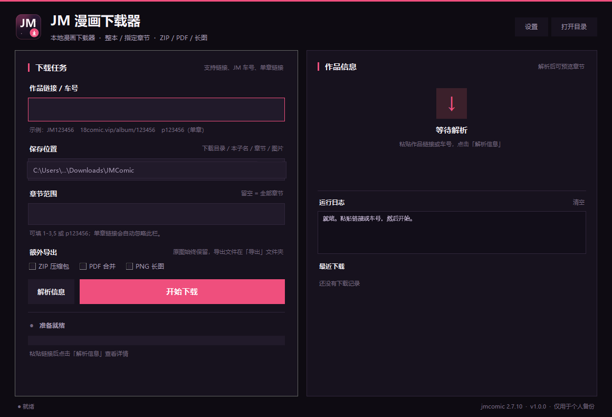

# JM 漫画下载器

一个安装在本机的 Windows 禁漫下载器，基于
[JMComic-Crawler-Python](https://github.com/hect0x7/JMComic-Crawler-Python)（`jmcomic 2.7.10`）。

> **原项目**：[hect0x7/JMComic-Crawler-Python](https://github.com/hect0x7/JMComic-Crawler-Python)（MIT）
>
> 本项目是非官方 Windows 图形界面封装，下载核心来自上述项目。请优先给原项目点 Star；
> 本项目与原作者无隶属关系。

界面使用 Python/Tkinter，下载核心使用 `jmcomic`，打包为独立的
`JMComicDownloader.exe`，不需要另外安装 Python。



## 功能

- 支持作品链接、`JM123456` 车号、纯数字车号、`p123456` 单章链接
- 整本下载，或只下载指定章节（`1-3,5`、`p123456`）
- 按「本子 / 章节 / 图片」自动建立目录
- 原图始终保留，可额外导出：
  - ZIP 压缩包
  - 合并 PDF
  - PNG 长图
- 下载进度、章节进度、运行日志、最近下载记录
- 可配置系统代理 / 自定义代理、AVS Cookie、APP 或网页端接口、并发数
- 关闭程序后设置和历史记录保留，未完成任务重新打开后可继续（已下载图片会跳过）

## 下载

不想自己构建的话，直接到
[Releases](../../releases/latest) 下载 `JMComicDownloader-Setup.zip`：

1. 解压压缩包。
2. 双击 `安装.cmd`，按提示完成安装。
3. 从桌面或开始菜单打开「JM 漫画下载器」。

也可以不安装，直接双击 `直接运行.cmd` 便携运行。

## 安装位置

默认按当前用户安装，不需要管理员权限：

| 内容 | 位置 |
| --- | --- |
| 程序 | `%LOCALAPPDATA%\Programs\JMComicDownloader\JMComicDownloader.exe` |
| 设置 / 历史 / 错误日志 | `%LOCALAPPDATA%\JMComicDownloader\` |
| 默认下载目录 | `%USERPROFILE%\Downloads\JMComic\` |

安装后会创建：

- 桌面快捷方式：`JM 漫画下载器`
- 开始菜单快捷方式：`JM 漫画下载器`
- Windows「应用和功能」中的卸载项

## 使用

1. 双击桌面的「JM 漫画下载器」。
2. 粘贴作品链接或输入车号，例如 `350234`。
3. 选择保存位置；章节范围留空即下载全部。
4. 如需 ZIP / PDF / 长图，勾选对应选项。
5. 点击「开始下载」。

下载结构示例：

```text
JMComic/
├─ [JM350234] 作品名/
│  ├─ 第1话 章节名/
│  │  ├─ 00001.webp
│  │  └─ ...
│  └─ 第2话 章节名/
└─ 导出/
   ├─ JM350234-作品名.zip
   ├─ JM350234-作品名.pdf
   └─ JM350234-作品名.png
```

导出文件生成在保存目录下的 `导出` 文件夹，原图不会被删除（除非你手动清理）。

### 设置说明

- **网络代理**：留空或 `system` 跟随系统；`none` 直连；也可填
  `127.0.0.1:7890` 这样的地址。
- **AVS Cookie**：只有少数需要登录的作品才需要。可以只填 `AVS` 的值，
  也可以粘贴完整 Cookie。
- **接口**：默认 APP 接口，兼容性较好；网页端在部分网络环境下成功率更高，
  但可能受地区限制。
- **并发**：默认图片 20、章节 4。数值越大下载越快，也越容易触发限流，
  建议保持默认。

## 卸载

任选一种：

- Windows 设置 → 应用 → 已安装的应用 → `JM 漫画下载器` → 卸载
- 运行安装目录中的 `Uninstall.cmd`
- 在 PowerShell 中运行：

  ```powershell
  powershell -ExecutionPolicy Bypass -File "$env:LOCALAPPDATA\Programs\JMComicDownloader\Uninstall.ps1"
  ```

卸载默认保留设置、历史记录和已经下载的漫画。如需同时清理设置与历史：

```powershell
powershell -ExecutionPolicy Bypass -File "$env:LOCALAPPDATA\Programs\JMComicDownloader\Uninstall.ps1" -PurgeData
```

下载的漫画文件不会自动删除。

## 从源码构建

要求 Windows 10/11、Python 3.12。

```powershell
python -m venv build\venv
build\venv\Scripts\python.exe -m pip install -r requirements-build.txt
.\build.ps1
```

生成 `dist\JMComicDownloader\JMComicDownloader.exe`（整个文件夹是一个完整程序，
不要只单独复制 exe）。安装到本机：

```powershell
powershell -ExecutionPolicy Bypass -File tools\install.ps1
```

构建脚本会先运行打包后的 `--self-test`，检查依赖、PDF 组件和配置生成是否正常。

## 常见问题

**第一次打开时 Windows 提示“已保护你的电脑”**
：这是未签名程序的 SmartScreen 提示。点击「更多信息」→「仍要运行」即可；
程序只在本机运行，不会上传下载记录。

**解析或下载失败，提示网络错误**
：先在「设置」中确认代理。能正常打开禁漫网页，不代表命令行/程序走了同一个代理；
可尝试填 `system`、`none`，或本机代理软件的实际端口。

**下载到一半停了**
：重新点击「开始下载」即可，已存在的图片会根据缓存配置跳过。

**需要登录 Cookie**
：在浏览器登录后，从开发者工具复制 `AVS` 的值填入设置；Cookie 区分域名，
确保浏览器访问的域名与程序使用的域名一致。

**PDF / 长图没有生成**
：确认勾选了对应选项，并查看运行日志。导出在整本（或单章）下载完成后才执行；
长图较大时生成时间会明显变长。

**错误记录在哪里**
：`%LOCALAPPDATA%\JMComicDownloader\last_error.log`。

## 说明与许可

- 本项目只是 `jmcomic` 的本地图形界面封装，下载能力来自上游项目。
- 请仅下载你有权保存的内容，遵守所在地法律法规和网站条款；请勿频繁批量抓取。
- 本项目与禁漫官方、`JMComic-Crawler-Python` 作者均无隶属关系。
- 封装代码以 MIT 许可发布；上游 `jmcomic` 为 MIT 许可。
  其他依赖的许可与来源见 `THIRD_PARTY_NOTICES.md`。
